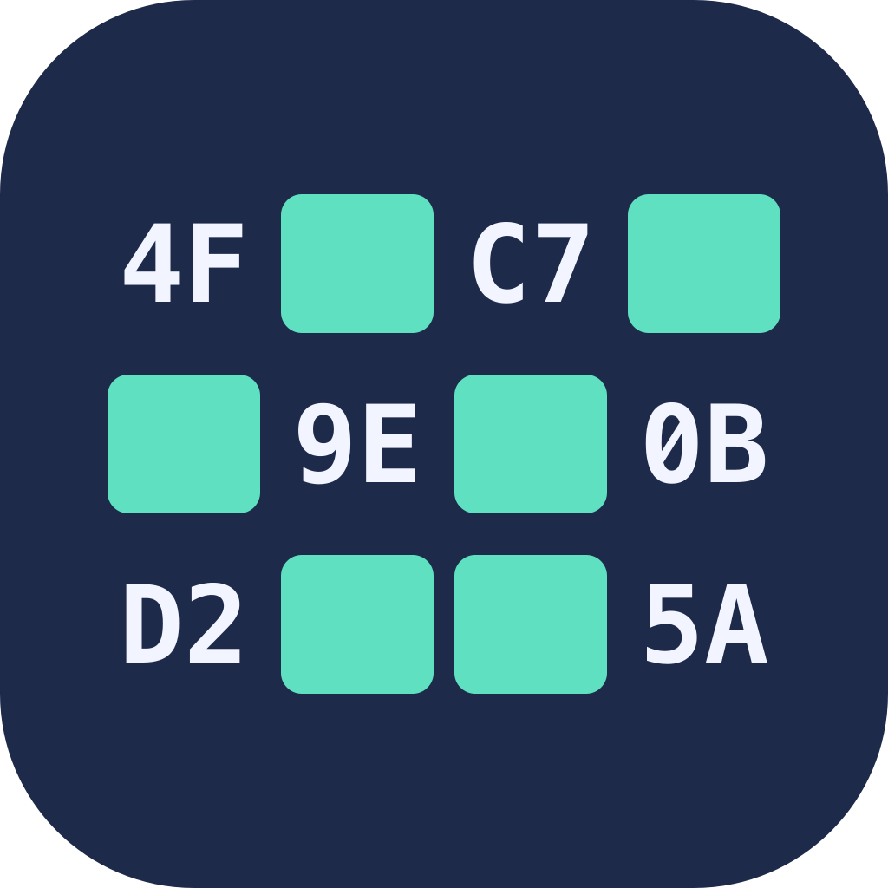

# Obfuscate



`obfuscate` is a macOS command-line tool that generates a Swift file for keeping secrets, such as API keys, out of your source code. Your app reads each secret from the generated `Secrets` enum:

```swift
let apiKey = try Secrets.openAI
```

The generated file never contains a secret in plain text, not even in a comment. Each secret is encrypted with ChaCha20-Poly1305 using its own random key, so you can commit `Secrets.swift` without your API keys appearing in source control.

The technique is based on a blog post at [NSHipster](https://nshipster.com/secrets/).

> [!IMPORTANT]
> This is **not** high-tech encryption. It's merely obfuscation: the key for each secret is in the same file. If *anyone* wants to crack this, it's trivially easy to do so. It just means they have to be motivated enough to do *some* work, rather than have the keys in plain sight.

> [!NOTE]
> Each time the command is run, it produces different output, because every secret is encrypted with a new random key.

<br clear="left">

## Installation

Obfuscate is built from source in Xcode. It needs macOS 26 or later.

1. Clone this repository and open `obfuscate.xcodeproj` in Xcode.
2. Choose **Product ▸ Build** (⌘B).

Each build installs `obfuscate` to `/usr/local/bin`, and its man page to `/usr/local/share/man/man1`, so `obfuscate` and `man obfuscate` work straight away.

- If either folder isn't writable, the build shows a warning with the command to fix it, for example `sudo chown -R $(id -un) /usr/local/share/man`.
- Debug builds are installed too, with a note in the build log. For an optimised binary, build the Release configuration:

  ```bash
  xcodebuild -scheme obfuscate -configuration Release build
  ```

Check the installed version with `obfuscate --version`.

## Usage

```
obfuscate [-c] [-f <file>] [-k <name=secret> ...] [<secret> ...]
```

| Option | Description |
|---|---|
| `<secret> ...` | Secrets to obfuscate. These become `Secrets.apiKey1`, `Secrets.apiKey2`, and so on. |
| `-k`, `--key <name=secret>` | A secret, and the name of the `Secrets` property that returns it. Repeat for more secrets. |
| `-f`, `--file-name <file>` | Write the generated Swift to this file instead of standard output. Adds `.swift` if necessary. |
| `-c`, `--check` | Check that every secret decodes correctly before writing any output. |
| `--version` | Show the version. |
| `-h`, `--help` | Show help. |

The generated Swift goes to standard output, so you can redirect it anywhere. All other messages go to standard error. See `man obfuscate` for the full details.

### Example

<!-- sample-command -->
```bash
obfuscate --key openAI=sk-example-1234 exampleKey
```

produces:

<!-- sample-output:start -->
```swift
import Foundation
import CryptoKit
import Playgrounds

// Secrets.swift

/// `Secrets` lets us obfuscate secrets, such as API keys, without committing the actual keys to source control
///
/// This enum was generated by the in-house CLI tool `obfuscate`, and should not be altered.
/// See `obfuscate -h` for more info on the tool
///
/// Reading a secret can throw, although it never should unless this file has been edited:
///
/// ```swift
/// let apiKey = try Secrets.apiKey1
/// ```
///
/// - Note: This method of obfuscating secrets was based on a blog post at
///   [NSHipster](https://nshipster.com/secrets/)
///
/// - Important: This is **not** high-tech encryption. It's merely obfuscation. If *anyone* wants to crack this,
///   it's trivially easy to do so. It just means they have to be motivated enough to do *some* work, rather
///   than have the keys in plain sight.
enum Secrets {
    /// Thrown when a secret can't be decrypted.
    ///
    /// This should never happen unless this file has been edited or corrupted.
    enum ObfuscateError: Error, LocalizedError {
        /// CryptoKit couldn't decrypt the secret.
        case decryptionFailed(underlying: any Error)

        /// The secret decrypted, but the result isn't valid UTF-8 text.
        case invalidUTF8

        /// What went wrong.
        var errorDescription: String? {
            switch self {
            case .decryptionFailed:
                "Couldn't decrypt a secret."
            case .invalidUTF8:
                "A decrypted secret isn't valid UTF-8 text."
            }
        }

        /// Why it went wrong.
        var failureReason: String? {
            switch self {
            case .decryptionFailed(let underlying):
                "CryptoKit reported: \(underlying.localizedDescription)"
            case .invalidUTF8:
                "The decrypted bytes don't form a valid UTF-8 string."
            }
        }

        /// What the developer can do about it.
        var recoverySuggestion: String? {
            "Secrets.swift has probably been edited or corrupted. Regenerate it with the obfuscate tool."
        }

        /// No Help Book anchor: this error is for developers, not end users.
        var helpAnchor: String? {
            nil
        }
    }

    /// Obfuscated secret `openAI`.
    ///
    /// - Throws: ``ObfuscateError`` if the secret can't be decrypted.
    static var openAI: String {
        get throws {
            let alice: [UInt8] = [
                0x02, 0xCB, 0xC0, 0xA4, 0x7D, 0x75, 0x06, 0xA7, 0x38, 0xE4, 0xAC, 0x96,
                0x7F, 0x81, 0xE4, 0xAC, 0x1B, 0xD8, 0x30, 0xF4, 0x88, 0x88, 0x42, 0x38,
                0x3D, 0xCD, 0x2F, 0x8B, 0x7D, 0xA8, 0x81, 0xE1, 0x7C, 0xBA, 0x94, 0x2F,
                0x00, 0xA7, 0x4F, 0x28, 0x95, 0x2A, 0x9A
            ]

            let bob: [UInt8] = [
                0xFD, 0x7E, 0x3B, 0xD5, 0x69, 0xD6, 0x9A, 0x23, 0x77, 0x5F, 0x1B, 0x47,
                0x41, 0x6D, 0xB5, 0x9A, 0x04, 0xC5, 0x5B, 0x7C, 0x05, 0xA9, 0xB3, 0x64,
                0xCE, 0xCC, 0xC2, 0x6F, 0x04, 0x15, 0x9E, 0x96
            ]

            return try decrypt(alice, bob)
        }
    }

    /// Obfuscated secret.
    ///
    /// Rename `apiKey1` (here and in the `#Playground` below) to describe what it's for.
    ///
    /// - Throws: ``ObfuscateError`` if the secret can't be decrypted.
    static var apiKey1: String {
        get throws {
            let alice: [UInt8] = [
                0x78, 0x13, 0xFF, 0x5C, 0x21, 0x03, 0x3D, 0x9C, 0x6F, 0xF9, 0x82, 0xFA,
                0x63, 0x85, 0x33, 0xCA, 0xBF, 0xF0, 0x46, 0x0A, 0x7B, 0xAB, 0x8E, 0x1A,
                0xA2, 0x34, 0x7C, 0xC6, 0x08, 0x53, 0xEC, 0x7F, 0x27, 0xF1, 0xB9, 0xA6,
                0x0B, 0x7F
            ]

            let bob: [UInt8] = [
                0x38, 0xD4, 0x63, 0x1D, 0xE2, 0xBA, 0xC4, 0x4C, 0x9F, 0x24, 0xDE, 0x09,
                0xB0, 0x59, 0xC7, 0x15, 0xE7, 0xDB, 0xB0, 0x36, 0x4F, 0x9F, 0xF2, 0xB3,
                0xE7, 0x51, 0xE8, 0x71, 0xB2, 0xEB, 0x26, 0xE9
            ]

            return try decrypt(alice, bob)
        }
    }

    /// Decrypts some bytes and returns the clear text.
    /// - Parameters:
    ///   - content: The encrypted content to be decrypted
    ///   - key: The key to use to decrypt it
    /// - Returns: The decrypted string
    /// - Throws: ``ObfuscateError`` if the content can't be decrypted.
    static func decrypt(_ content: [UInt8], _ key: [UInt8]) throws -> String {
        let decrypted: Data
        do {
            let sealedBox = try ChaChaPoly.SealedBox(combined: Data(content))
            decrypted = try ChaChaPoly.open(sealedBox, using: SymmetricKey(data: Data(key)))
        } catch {
            throw ObfuscateError.decryptionFailed(underlying: error)
        }

        guard let secret = String(bytes: decrypted, encoding: .utf8) else {
            throw ObfuscateError.invalidUTF8
        }
        return secret
    }
}

#Playground("Check API Coding") {
    _ = try Secrets.openAI
    _ = try Secrets.apiKey1
}
```
<!-- sample-output:end -->

### Naming your secrets

Plain secrets become `Secrets.apiKey1`, `Secrets.apiKey2`, and so on, with a comment asking you to rename them. To choose the names yourself, use `--key name=secret` (or `-k`), once per secret:

```bash
obfuscate --key openAI=sk-abc123 --key stripe=pk_live_xyz
```

This generates `Secrets.openAI` and `Secrets.stripe`.

- The name is everything before the first `=`, so secrets containing `=` (such as base64) work as expected.
- Names must be Swift identifiers (ASCII letters, digits and underscores, not starting with a digit).
- A name can't be a Swift keyword, `decrypt`, `ObfuscateError`, or a name used by another secret.

If a `--key` is invalid, the error identifies it by position (for example `--key #2`) and never repeats the secret.

### Using your secrets

Each secret is a throwing property, so read it with `try`:

```swift
let apiKey = try Secrets.openAI
```

It should never throw. If it does, `Secrets.swift` has been edited or corrupted, and the error is a `Secrets.ObfuscateError` with a description, a reason and a recovery suggestion. You decide how to handle it: for example, log it and disable the feature that needs the key, rather than crash.

The generated file compiles without warnings in Swift 6 mode, and passes SwiftLint's default rules.

### Saving and checking

- **Redirect** standard output: `obfuscate --key openAI=sk-abc123 > Secrets.swift`
- **Write a file** with `-f`: `obfuscate -f Secrets --key openAI=sk-abc123` writes `Secrets.swift` and reports `Saved to Secrets.swift` on standard error.
- **Check first** with `-c`: every secret is decrypted and compared with the original before anything is written. Results are reported by name only, and the secrets are never printed:

  ```
  ✅ openAI decodes correctly
  ```

### Exit status

| Status | Meaning |
|---|---|
| `0` | Success. |
| `1` | A check failed, the output file couldn't be written, or a secret couldn't be encrypted. |
| `64` | Invalid usage: no secrets, an invalid `--key`, or an unknown option. |

### Keeping secrets out of your shell history

Secrets passed on the command line are saved in your shell history. In zsh, with `setopt HIST_IGNORE_SPACE` set, starting the command with a space keeps it out of the history.

## Development

- The command-line tool is in `obfuscate/`. The core logic (parsing, encryption, and the template for the generated file) is in the local Swift package `ObfuscateKit/`.
- The build's install and SwiftLint steps are shell scripts in `Scripts/`, which the Xcode build phases call. SwiftLint findings appear as build warnings (install SwiftLint with `brew install swiftlint`).
- Project notes (conventions, gotchas, plan, status and a development journal) are in `Documentation/`.
- Run the tests from the repository root:

  ```bash
  Scripts/test-all.sh               # all of the below, with a summary of each
  (cd ObfuscateKit && swift test)   # unit tests (Swift Testing)
  Scripts/test-obfuscate.sh         # end-to-end tests of the installed obfuscate
  Scripts/test-install-scripts.sh   # tests of the install and SwiftLint scripts, in temporary folders
  ```

  `test-obfuscate.sh` tests the `obfuscate` on your `PATH`, so build first, or set `OBFUSCATE=/path/to/obfuscate`. It also checks that the example in this Readme matches the tool's real output.

## Contributing

Pull requests are welcome. For major changes, please open an issue first to discuss what you would like to change.

Please make sure the test scripts pass, and add tests for new behaviour.

## Licence

Obfuscate is released under the [MIT License](LICENSE).

© 2025–2026 Xerodonia Pty Ltd
